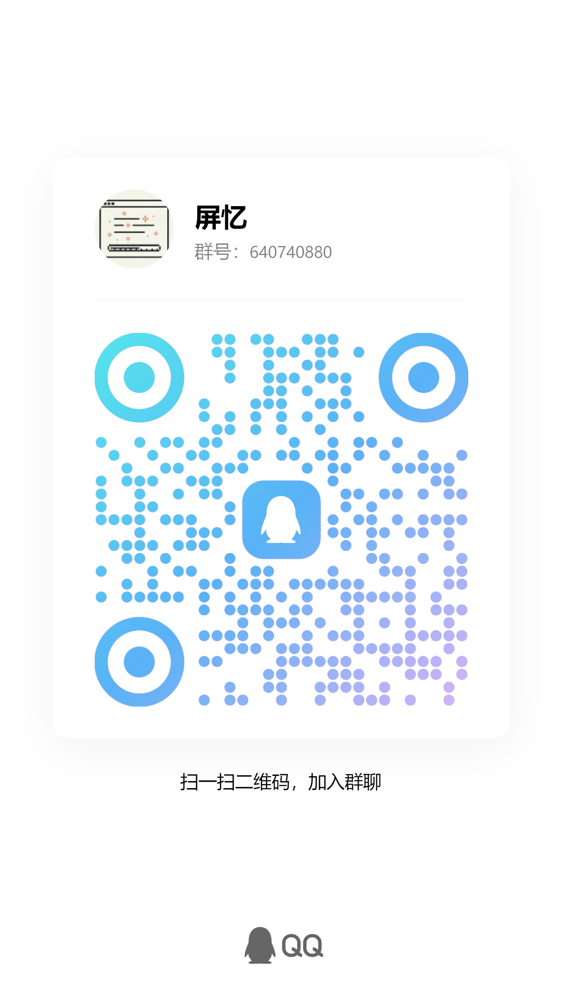

<div align="center">


# ScreenMemo

A locally-run intelligent screen capture memo and retrieval tool: automatically record your Android screen, and make content searchable and reviewable through OCR and AI assistants.

"Screen traceless, memory timeless"

[](https://dart.dev) [](https://www.android.com) [](LICENSE) [](https://qm.qq.com/q/ob2NMRDzna) [](https://github.com/2977094657/ScreenMemo/releases)

</div>

<p align="center">
  <b>Language</b>:
  <a href="README.zh.md">简体中文</a> |
  English |
  <a href="README.ja.md">日本語</a> |
  <a href="README.ko.md">한국어</a>
</p>

---

## Project Overview

ScreenMemo is an intelligent screen capture memo and retrieval tool that runs locally: it automatically records your Android device's screen and makes information searchable via OCR and AI assistants, helping you quickly find clues and restore context when needed.

### Start Building Your Personal Digital Memory Today

**Why start now?**

- **Irreversible Knowledge Loss**: As more people start feeding personal AI with daily data, every day left unrecorded means your future AI assistant will be less "aware" of you.
- **The Quiet Power of Time Compounding**: Data cannot be fast-tracked. Those who start accumulating digital specimens today will naturally possess an exclusive memory bank that others will find hard to catch up to when AI reaches its qualitative leap.
- **Salvaging Scattered Digital Selves**: Your most valuable context is often scattered across different apps and devices; without ScreenMemo to properly house them, they will eventually dissipate with time and become difficult to fully awaken.

## App Screenshots

Below are combined screenshots organized by functional themes, each corresponding to a complete usage scenario.

<table>
  <tr>
    <td align="center" valign="top">
      
      <div align="center"><sub>Core Entry: Record, Search, and Timeline</sub></div>
    </td>
    <td align="center" valign="top">
      
      <div align="center"><sub>Search and Results Summary</sub></div>
    </td>
  </tr>
  <tr>
    <td align="center" valign="top">
      
      <div align="center"><sub>Timeline, Calendar, and Replay Generation</sub></div>
    </td>
    <td align="center" valign="top">
      
      <div align="center"><sub>AI Review, Daily Summary, and Request Logs</sub></div>
    </td>
  </tr>
  <tr>
    <td align="center" valign="top">
      
      <div align="center"><sub>AI Memory Retrieval and Chart Organization</sub></div>
    </td>
    <td align="center" valign="top">
      
      <div align="center"><sub>Favorites, Loading, and Notes</sub></div>
    </td>
  </tr>
  <tr>
    <td align="center" valign="top">
      
      <div align="center"><sub>Capture Settings, Compression, and Storage Analysis</sub></div>
    </td>
    <td align="center" valign="top">
      
      <div align="center"><sub>Settings, Permissions, and Dynamic Tasks</sub></div>
    </td>
  </tr>
  <tr>
    <td align="center" valign="top">
      
      <div align="center"><sub>MCP Services, AI Providers, and Semantic Models</sub></div>
    </td>
    <td align="center" valign="top">
      
      <div align="center"><sub>Privacy Mode and Sensitive Content Controls</sub></div>
    </td>
  </tr>
</table>

## Quick Start

### For General Users

If you just want to use ScreenMemo on your phone, it is recommended to install the pre-built APK from GitHub Releases.

1. Open [GitHub Releases](https://github.com/2977094657/ScreenMemo/releases) and go to the latest version.
2. In **Assets**, download the `screen_memo-...-app-*-release.apk` package suitable for your phone. For most Android phones from recent years, prioritize `arm64-v8a`.

### For Developers

#### Environment Requirements

- **Flutter SDK**: `3.35.7` (current CI verified version)
- **Dart SDK**: `3.9.2` (provided with Flutter `3.35.7`; project constraint is `>=3.8.1`)
- **JDK**: Recommended `17` (CI uses `17`; Android code still targets Java 11 bytecode)
- **Android SDK**: Release workflow uses `Platform 36`, `Build-Tools 36.0.0`, `NDK 27.0.12077973`
- **APK Current Build Config**: `minSdk 24`, `targetSdk 36`
- **Main Feature Platform Requirement**: Automatic screen capture requires Android 11 (API 30) or higher.
- **Capture Interval**: The default and minimum value has been adjusted to `1` second. Screenshot capture and post-processing are executed asynchronously in the background and will not block the next capture trigger.
- **IDE**: Android Studio / VS Code + Flutter plugin

#### Installation and Execution

1. **Clone the Project**
   ```bash
   git clone <repository-url>
   cd screen_memo
   ```

2. **Install Dependencies**
   ```bash
   flutter pub get
   ```

3. **Generate Internationalization Code**
   ```bash
   flutter gen-l10n
   ```

4. **Run the App**
   ```bash
   flutter run
   ```

#### Testing on PC via Android Emulator

1. Create an Android 11+ emulator in Android Studio's **Device Manager**.
2. After starting the emulator, execute:
   ```bash
   flutter emulators
   flutter devices
   flutter run -d <device_id>
   ```

For more maintainer development details, see [`docs/DEVELOPMENT.md`](docs/DEVELOPMENT.md).

#### Development and Validation Commands

```bash
# Code analysis
flutter analyze

# Flutter tests
flutter test

# i18n audit
dart run tool/i18n_audit.dart --check

# Debug APK
flutter build apk --debug

# Release APK (Split per ABI)
flutter build apk --release --split-per-abi --tree-shake-icons --obfuscate --split-debug-info=build/symbols
```

#### Functional Testing and Regression Protection

Android native JVM unit tests:

**Windows**
```powershell
cd android
.\gradlew.bat test
```

**macOS / Linux**
```bash
cd android
./gradlew test
```

## MCP Service and Client

ScreenMemo supports bidirectional MCP: you can manually enable a read-only Local Area Network (LAN) MCP service on your phone, or act as an MCP client to connect to other external MCP services, allowing the in-app AI to call these external tools during chats.

### LAN MCP Server

The LAN MCP service allows AI clients within the same network to read dynamic summaries, search results, context fragments, and a limited number of explicitly requested evidence images.

- Manually enable the LAN MCP service in "Settings → MCP Service" of the Android App.
- The endpoint is fixed at `http://<phone_lan_ip>:37621/mcp`, and requests must include `Authorization: Bearer <token>`.
- Standard MCP clients should retrieve tools via `tools/list` and call them via `tools/call`. To maintain compatibility with some clients, calling the declared tool name directly as a JSON-RPC `method` is also supported.
- By default, it will not return OCR raw text or base64 images. Sensitive content is only returned when the tool parameter `include_ocr` is explicitly enabled or when `get_evidence_images` is called, and it is subject to quantity/length limits.
- If port `37621` is occupied, the settings page will display a startup error; it will not automatically switch to a random port.

### External MCP Client

- You can add, edit, sync, start/stop, and delete external MCP services using JSON in "Settings → MCP Service → External MCP servers".
- Claude / RikkaHub style `mcpServers` JSON is supported during add/edit:
  ```json
  {
    "mcpServers": {
      "demo": {
        "type": "streamable_http",
        "url": "https://example.com/mcp",
        "headers": {
          "Authorization": "Bearer YOUR_TOKEN"
        }
      }
    }
  }
  ```
  - External MCP clients support `streamable_http` and the older HTTP+SSE (`sse`) transport. Unsupported transports will throw an explicit error during saving or syncing rather than silently downgrading.
  - During synchronization, MCP `initialize`, `notifications/initialized`, and `tools/list` are called, and tool names, descriptions, and input schemas are cached. Subsequent syncs will preserve the user's existing tool enabled states.
  - When external tools are exposed to the AI, they are automatically named `mcp__<server>__<tool>__<hash>` to avoid tool name conflicts between multiple MCP services.
  - Newly synced external tools are disabled by default. Users can enable tools in the settings page or ask the AI in chat to configure and sync the MCP. MCP configurations, synchronizations, and calls to enabled external tools initiated by the AI will execute directly and refresh the available tools for the current chat session.

### Theme Colors

- You can customize the current default color scheme in "Settings → Display and Sorting → Theme Color".
- The top-right corner of the panel supports pasting JSON for import and one-click copying of the current color JSON for easy sharing and restoration.
- Sensitive values in request headers are masked in the UI, logs, and chat tool results. Output from external MCP tools should still be treated as untrusted data.

## Skills

ScreenMemo supports RikkaHub-style local Skill extensions: users can install skill directories containing a `SKILL.md` file, allowing the in-app AI to load specialized instructions and accompanying files on demand during chats.

- You can create a skill by pasting a single `SKILL.md` in "Settings → Skills".
- Individual skills can be enabled/disabled in the Skills list. Only enabled skills are exposed to the AI chat.
- Clicking into skill details allows you to view the full file list, copy file contents, edit `SKILL.md` or associated text files, add new associated files, and delete non-`SKILL.md` files.
- During chat, the AI loads skills via the `use_skill` tool: if no `path` is provided, the body of `SKILL.md` and the list of available files are returned; if a safe relative path is provided, the corresponding associated file is read. Read paths are always restricted to within that skill's directory.
- Skill content comes from local user-installed extensions and should still be treated as an external instruction source. Do not place tokens, keys, or private data in skill directories.

## Support the Project

If ScreenMemo has helped you recover important clues, feel free to support the project and donate to the author.

<div align="center">
  <table>
    <tr>
      <td align="center" valign="top">
        
        <div align="center"><sub>WeChat</sub></div>
      </td>
      <td align="center" valign="top">
        
        <div align="center"><sub>Alipay</sub></div>
      </td>
    </tr>
  </table>
</div>

## Community Chat

<div align="center">
  <table>
    <tr>
      <td align="center" valign="top">
        <a href="https://qm.qq.com/q/ob2NMRDzna">
          
        </a>
        <div align="center"><sub>QQ Group: 640740880</sub></div>
        <div align="center"><sub><a href="https://qm.qq.com/q/ob2NMRDzna">Click link to join the [ScreenMemo] group chat</a></sub></div>
      </td>
    </tr>
  </table>
</div>

## Frequently Asked Questions (FAQ)

<details>
<summary>How much storage space is used per month?</summary>

- Empirical example: If a compressed image is ~50 KB and captures are taken once per minute, 30 days will result in ~43,200 images, approximately 2.1 GB / month.
- Estimation formula: Monthly Usage (GB) ≈ `(60 ÷ capture_interval_seconds) × 60 × 24 × 30 × image_size(KB) ÷ 1024 ÷ 1024`
- Tips to reduce usage: Increase capture interval, enable target size compression, turn on expiration cleanup, or only enable capture for required apps.
- Existing historical screenshots can be globally compressed by target size in "Settings → Capture Settings → Global History Compression". Canceling this will immediately stop new image processing tasks.
- Once a replay video is successfully saved to the system gallery, the temporary internal video copy is automatically deleted. Existing historical replay copies can be cleaned up in "Storage Analysis → Replay Video".
</details>

<details>
<summary>Will data be uploaded to the cloud?</summary>

- By default, no. Screenshots, OCR, indices, statistics, and most configurations are saved locally.
- Only when you explicitly enable AI capabilities and configure a provider will relevant summary/dialogue requests be sent to the model service you configured.
</details>

<details>
<summary>Which AI providers are supported?</summary>

- Currently built-in provider types include `OpenAI`, `Azure OpenAI`, `Claude`, `Gemini`, and `Custom`.
</details>

<details>
<summary>How to back up / migrate data?</summary>

- You can export a ZIP backup in "Data and Backup". Before exporting, the app scans the range, generates a manifest, and shows categorical progress.
- During import, "Overwrite Import" and "Merge Import" are supported. Merge mode attempts to deduplicate and preserve existing data.
- Merge import only merges screenshots, indices, and database data under `output`. Root configuration directories in full backups, such as `shared_prefs`, `app_flutter`, and `no_backup`, are automatically skipped.
- For multiple large backups, it is recommended to use the desktop merge tool on a PC before transferring back to the phone.
- If you find missing indices or OCR after importing, you can run diagnostics and OCR repairs in "Import Diagnostics".
- Backups do not include cache, code cache, temporary thumbnails, and external logs by default.
</details>

<details>
<summary>What is the impact on battery and performance?</summary>

- This primarily depends on the capture interval, compression strategy, AI reconstruction frequency, and background persistence status.
- It is recommended to enable target size compression and expiration cleanup, and use app-specific filtering strategies to avoid continuous capture of unimportant apps.
</details>

## Desktop Data Merger Tool

Since processing multiple large backup ZIPs on a mobile device is slow, the project provides an additional desktop merge entry: `lib/main_desktop_merger.dart`.

- Select multiple ZIP backup files and an output directory.
- Performs structure pre-checks before merging to detect corrupt packages or incompatible data early.
- Merges the `output` data tree from backups: screenshot files, sharded databases, and main database metadata, while skipping duplicate content.
- Merges metadata such as favorites, NSFW tags, and user settings.
- Displays real-time processing progress, warnings, affected apps, and deduplication results.
- Repackages the merged result into a new ZIP file upon completion.

### Build Commands

**Windows**
```powershell
flutter build windows -t lib/main_desktop_merger.dart --release
```

**macOS**
```bash
flutter build macos -t lib/main_desktop_merger.dart --release
```

**Linux**
```bash
flutter build linux -t lib/main_desktop_merger.dart --release
```

## Permissions

| Permission | Purpose | Recommendation |
| --- | --- | --- |
| Notification Permission | Foreground services, Export/Repair/Rebuild progress, Daily reminders | Recommended |
| Accessibility Service | Automatic screenshots, Activity reconstruction, some background AI workflows | Required for main features |
| Usage Stats Permission | Foreground app identification, app-dimension filtering and statistics | Highly Recommended |
| Installed App Visibility | Read installed app list for app selection, auto-adding new apps, filtering and statistics | Required for main features |
| Ignore Battery Optimization / Auto-start | Improve stability of background capture and reconstruction | Highly Recommended |
| Exact Alarm | Daily summary reminders | Optional |
| Gallery / Download Write | Save screenshots, replay videos, or export results | Optional |

## Internationalization

The current README and app interface are maintained in the following four languages:

- 简体中文 (Simplified Chinese)
- English
- 日本語 (Japanese)
- 한국어 (Korean)

App interface copy is centrally maintained in `lib/l10n/app_*.arb`, while native Android notifications, permission descriptions, and foreground service copy are maintained in `android/app/src/main/res/values*/strings.xml`. When adding new UI text, do not write it directly in Dart Widgets or Android XML attributes; first add the corresponding language resources and re-run `flutter gen-l10n`.

Common commands:

```bash
# Generate l10n code
flutter gen-l10n

# Check for ARB / Platform / UI hardcoding regressions
dart run tool/i18n_audit.dart --check

# Update baseline after confirming exceptions
dart run tool/i18n_audit.dart --update-baseline
```

`flutter test` automatically runs `test/i18n_audit_test.dart` to prevent new multilingual regressions.

## Contribution Guide

Contributions of code, bug reports, or suggestions are welcome.

1. Fork this project
2. Create a branch: `git checkout -b feature/your-change`
3. Commit changes: `git commit -m "feat: describe your change"`
4. Push branch: `git push origin feature/your-change`
5. Submit a Pull Request

It is recommended to run at least the following before submitting:

- `flutter analyze`
- `flutter test`
- `dart run tool/i18n_audit.dart --check`
